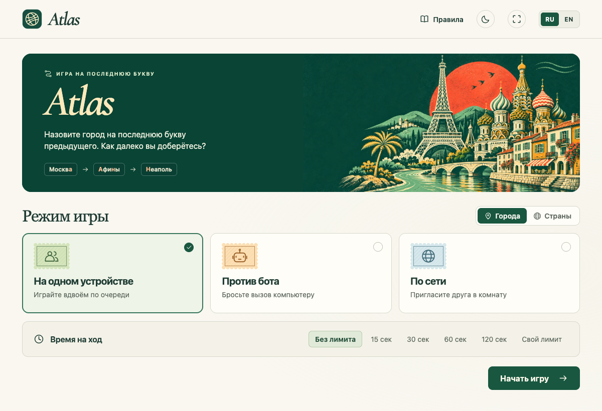
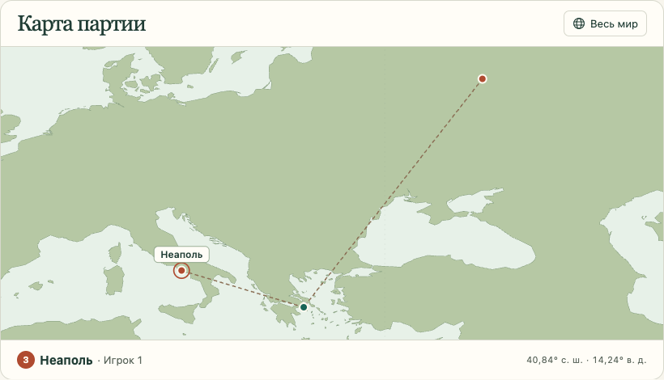
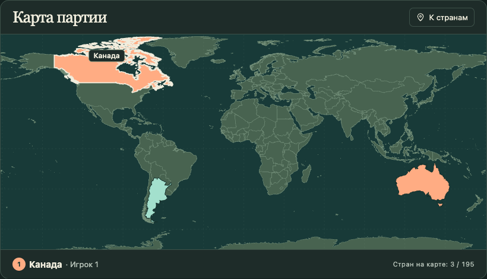

# Atlas

Atlas — браузерная игра в города и страны на последнюю букву. Играйте вдвоём за одним экраном, против бота или с другом по сети. Каждый ответ меняет карту партии: города складываются в маршрут, а страны закрашиваются цветами игроков.



## Быстрый старт

Понадобится **Node.js 20 или новее** с npm. Сервер использует встроенные модули Node.js. Из свежей копии проекта можно сразу запускать игру без установки пакетов и сборки.

1. На странице репозитория GitHub выберите **Code → Download ZIP** и распакуйте архив. Если пользуетесь Git, можно скопировать HTTPS-адрес из меню **Code** и клонировать репозиторий командой `git clone`.
2. Откройте терминал в папке с файлом `package.json` и выполните:

   ```sh
   npm start
   ```

3. Откройте [localhost:3000](http://localhost:3000/), выберите «Города» или «Страны», укажите соперника и нажмите **«Начать игру»**.

Держите терминал открытым, пока играете. Чтобы остановить сервер, нажмите `Ctrl+C`. Если порт 3000 занят, в macOS и Linux подойдёт команда `PORT=8080 npm start`. В Windows PowerShell сначала выполните `$env:PORT = "8080"`, затем `npm start`. Адрес для браузера появится в строке `Local`.

## Как играть

Первый игрок называет любой город или страну из выбранного словаря. Следующий игрок продолжает цепочку с последней буквы названия. Повторять сыгранное место нельзя, включая другие варианты его названия.

- **Города.** Москва → Афины → Неаполь. В русском языке игра пропускает конечные **ь**, **ъ** и **ы**, поэтому после Афин нужен город на **н**. Буквы **е** и **ё** равнозначны. В каждом из двух языковых словарей больше 6 500 городов.
- **Страны.** Канада → Аргентина → Австралия. В словаре 195 стран. Сокращение «США» и полное название «Соединённые Штаты Америки» засчитываются как одна страна.
- **Окончание партии.** Если игрок сдаётся, пропускает установленное время или в словаре заканчиваются подходящие ответы, побеждает соперник. По умолчанию время свободное. Можно выбрать 15, 30, 60, 120 секунд или задать свой лимит от 1 до 1200 секунд на ход.

Переключатель **RU / EN** в меню задаёт язык интерфейса и новой партии. В шапке также доступны правила, светлая и тёмная темы и полноэкранный режим.

## Карта партии

В «Городах» точки показывают, кто назвал город, а пунктир соединяет ходы по порядку. Нажмите на точку, чтобы посмотреть название, номер хода и координаты. Кнопка **«К городам»** приближает сыгранный маршрут.



В «Странах» после хода закрашивается территория государства. Для маленьких стран добавлена метка. На снимке первый игрок назвал Канаду и Австралию, второй — Аргентину.



Словари и карты входят в репозиторий и загружаются с игрового сервера. [Источники геоданных и названий](DATA-NOTICE.md)

## Как подключить второго игрока

1. Подключите оба устройства к одной Wi-Fi-сети. Запустите `npm start` на компьютере. Второму игроку достаточно браузера.
2. На компьютере откройте игру, выберите тему, язык и время на ход. Нажмите **«По сети» → «Создать комнату»**.
3. На втором устройстве откройте **адрес из строки `LAN`** в терминале компьютера, например `http://192.168.1.25:3000`. Выберите **«По сети» → «Войти по коду»** и введите шестисимвольный код комнаты.
4. Партия начнётся, когда второй игрок подключится. Оба увидят одну карту и получат настройки создателя комнаты.

Для игры через интернет запустите тот же Node.js-сервер на хостинге, доступном обоим игрокам. Комнаты хранятся в памяти одного процесса. Обновление страницы в той же вкладке восстанавливает сетевую партию, а перезапуск сервера очищает комнаты. Комнаты без обращений удаляются через шесть часов.

## Голосовые ходы

Нажмите микрофон во время своего хода, разрешите доступ и произнесите название на языке партии. Ответ отправится автоматически. Если игра отклонила название, можно сразу назвать другое. При игре с ботом или по сети микрофон возобновляет прослушивание на вашем ходу. Повторное нажатие выключает голосовой режим.

Для микрофона используйте `localhost` на компьютере с сервером или HTTPS при удалённом подключении. Поддержка распознавания зависит от браузера. Он может передавать звук своему речевому сервису. Ввод с клавиатуры доступен во всех режимах. [Документация Web Speech API](https://developer.mozilla.org/en-US/docs/Web/API/SpeechRecognition)

## Тесты

Из корня проекта выполните:

```sh
npm test
```

Тесты проверяют правила цепочки, таймер, варианты названий, геоданные, сетевую партию двух клиентов и обработку событий голосового ввода.
